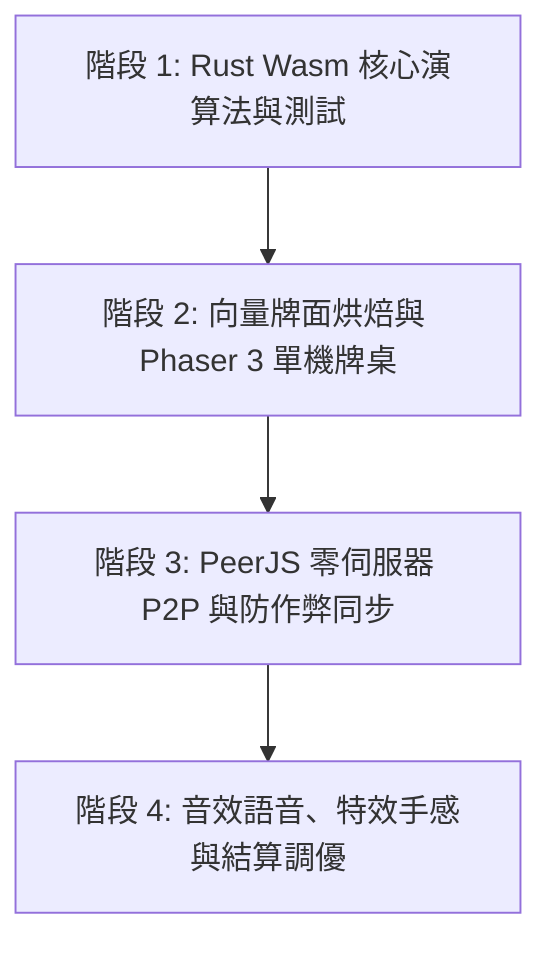

# 台灣 16 張麻將遊戲開發計畫書 (01-project-proposal.md)

本專案架構對齊 [`tank`](file:///C:/workspace/tank) 專案模式，採「**100% 零伺服器純前端優先、Phaser 3 牌桌渲染、WebRTC P2P 直連、Rust/Wasm 同構規則核心、向量程序化牌面 + AI 美術管線**」實作標準台灣 16 張麻將（閒家 16 張、摸牌 17 張成胡）。

---

## 1. 技術棧選型與規格對齊 (Tech Stack)

| 領域 | 技術選型 | 角色職責 |
|---|---|---|
| **前端應用層** | **Vue 3 + TypeScript (`vue-tsc`)** | 大廳介面、房號配對、底台規則設定、疊加操作 HUD（吃/碰/槓/聽/胡/過面板）、台數結算單 |
| **建置工具** | **Vite 6 + pnpm 10** | 極速 HMR、Wasm 打包與靜態資源管理 |
| **樣式系統** | **Tailwind CSS 4 (`@tailwindcss/vite`)** | 全視窗 `100dvh` (`fixed inset-0`) 零捲動街機駕駛艙佈局、牌桌四角資訊區與彈窗面板 |
| **遊戲引擎** | **Phaser 3 (`phaser@3.90.x`)** | 2.5D 俯視牌桌、手牌立牌/倒牌渲染、摸打拋物線 Tween、牌海（River）排列、吃碰槓胡粒子特效 |
| **P2P 連線層** | **PeerJS (`peerjs@1.5.x`)** | 星狀拓撲（1 Host + 3 Guests），預設直連官方公共信令池 (`0.peerjs.com`)，支援 `VITE_PEER_HOST` 自建信令自動 Fallback 與開局 `lockRoom()` 防亂入 |
| **核心演算與防作弊** | **Rust → Wasm (`wasm-pack`, `crates/mahjong-core`)** | 144 張牌定義、確定性洗牌與雜湊承諾驗證、吃碰槓胡合法性與優先序裁決、台灣 16 張台數引擎、單機向聽數 Bot AI |
| **測試框架** | **Vitest + `cargo test`** | Rust 核心牌型/算台單元測試（`pnpm test:rust`）與前端狀態機整合測試（`pnpm test`） |
| **伺服器規劃** | **無 (0 Server Cost)** | 純靜態部署（GitHub Pages / Cloudflare Pages），以固定前綴 Peer ID（`twmj-<6碼房號>`）直連配對，不維護後端目錄伺服器 |
| **美術管線** | **程式化向量繪製 (`@resvg/resvg-js`) + AI 生圖切片** | 42 種麻將牌面採 SVG 腳本精準烘焙（確保字體與花色絕對清晰對齊）；牌桌絨布、角色立繪與 UI 框採 AI 生圖 + 洋紅去背切割腳本 |

---

## 2. 核心架構設計 (Architecture)

### 2.1 VSA 垂直切片結構 (Vertical Slice Architecture)

遵循務實 DDD 與 YAGNI 原則：跨切片僅透過 `src/shared/kernel/types.ts` 或各切片 `index.ts` 互動；小型模組（如 `audio`）維持單檔實作，不預留無用抽象層。

```text
mj/
├── crates/
│   └── mahjong-core/             # Rust 核心演算法 (編譯為 WebAssembly)
│       ├── src/
│       │   ├── lib.rs            # wasm-bindgen 匯出介面
│       │   ├── tile.rs           # 144 張牌編碼 (萬/筒/條 108 + 風/三元 28 + 四季四君子花牌 8)
│       │   ├── wall.rs           # 確定性洗牌、牌山游標、海底留 16 張 (鐵八墩)、槓牌嶺上補花游標
│       │   ├── hand.rs           # 手牌結構 (暗牌 + 明副露 Chii/Pon/Kong + 花牌) 與自動理牌
│       │   ├── meld_check.rs     # 吃/碰/明槓/暗槓/加槓/搶槓 合法性與攔胡優先權判定
│       │   ├── win_check.rs      # 17 張 (5 面子 + 1 雀頭) 與特殊牌型 (嚦咕嚦咕/八仙過海/七搶一) 胡牌檢驗
│       │   ├── yaku.rs           # 台灣 16 張台數與底台結算引擎
│       │   └── bot.rs            # 向聽數 (Shanten) 計算與防禦/進攻出牌啟發式 AI
│       └── Cargo.toml
├── docs/                         # 專案規劃、架構規則與 Subagent 派發文件
├── tools/                        # 美術資產烘焙與切片管線
│   ├── paint_tiles.mjs           # SVG → PNG 程式化繪製 42 種高解析麻將牌面與牌背 Atlas
│   └── slice_ui.py               # 切割 AI 生成之洋紅底色 UI / 特效 Sprite Sheet
├── src/
│   ├── features/
│   │   ├── table/                # 牌桌主切片
│   │   │   ├── domain/           # 牌局確定性狀態機 (tableState.ts)
│   │   │   ├── application/      # 牌局回合調度與本機/P2P 訊息協調 (useTableSession.ts)
│   │   │   ├── engine/           # Phaser 3 牌桌場景 (TableScene.ts)
│   │   │   ├── ui/               # 100dvh 疊加 HUD (TableArena.vue, ActionHud.vue, SettlementModal.vue)
│   │   │   └── index.ts
│   │   ├── lobby/                # 大廳與房間配對切片
│   │   │   ├── domain/           # 房號生成、座位風位分配 (roomSession.ts)
│   │   │   ├── infra/            # PeerJS 星狀連線介面卡 (peerAdapter.ts)
│   │   │   ├── ui/               # 開房/入房面板 (LobbyHub.vue)
│   │   │   └── index.ts
│   │   └── audio/
│   │       └── index.ts          # 單檔音效合成與語音觸發 (理牌/摸打碰撞聲/吃碰槓胡語音)
│   ├── shared/
│   │   ├── kernel/
│   │   │   └── types.ts          # 全域型別與 P2P 協定訊息 (PlayerId, SeatWind, TileId, ProtocolMessage)
│   │   ├── wasm/
│   │   │   └── index.ts          # mahjong-core Wasm 載入與同步包裝
│   │   └── ui/                   # 共用 UI 元件
│   ├── App.vue
│   └── main.ts
├── AGENTS.md
├── todo.md
├── package.json
└── vite.config.ts
```

---

## 3. 分階段執行路線圖 (Phased Roadmap)



詳細之規格與工作包拆分請見 [`02-architecture-and-rules.md`](./02-architecture-and-rules.md) 與 [`03-execution-plan.md`](./03-execution-plan.md)。
