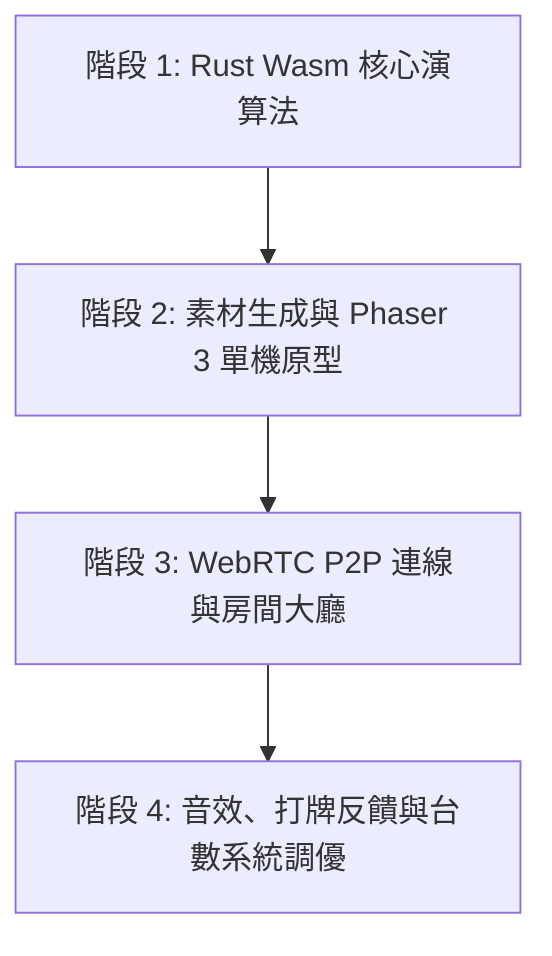

# 17 張台灣麻將遊戲開發計畫書 (Plan.md)

本專案規格與架構設計完全參照 [`tank`](file:///C:/workspace/tank) 專案模式，採「純前端優先、Phaser 3 現成引擎渲染、WebRTC P2P 連線、Rust/Wasm 雙核同構驗證、AI 圖像生成與素材管線」進行實作。

---

## 1. 技術棧選型與規格對齊 (Tech Stack)

| 領域 | 技術選型 | 角色職責 |
|---|---|---|
| **前端應用層** | **Vue 3 + TypeScript (`vue-tsc`)** | 大廳介面、房間列表、規則設定、戰績報表、疊加操作 HUD（吃/碰/槓/聽/胡面板） |
| **建置工具** | **Vite 6 + pnpm 10** | 極速 HMR、靜態資源管理與多模組打包 |
| **樣式系統** | **Tailwind CSS 4 (`@tailwindcss/vite`)** | 牌桌 HUD、暗黑/木質牌桌主題、全視窗 `100dvh` 零捲動駕駛艙佈局 |
| **遊戲引擎** | **Phaser 3 (`phaser@3.90.x`)** | 2.5D/俯視牌桌渲染、手牌堆疊、打牌拋物線、碰槓動畫、出牌高亮、特效粒子系統 |
| **P2P 連線層** | **PeerJS (`peerjs@1.5.x`)** | 預設使用官方公開免費信令雲 (`0.peerjs.com`)，房間代碼配對，WebRTC DataChannel 4 人直連，**第一階段達成 100% 零伺服器純前端託管** |
| **暗牌密碼學** | **`@noble/hashes` (SHA-256)** | Commit-Reveal 承諾洗牌協議，防止 P2P 模式下透視暗牌堆與作弊 |
| **核心演算 (WASM)** | **Rust (`wasm-pack`, `crates/mahjong-core`)** | 16+1 張麻將理牌、胡牌遞迴/查表檢驗、聽牌分析、台灣 16 張經典台數結算、單機 Bot AI |
| **伺服器規劃** | **無 (0 Server Cost)** | 第一階段完全不架設後端伺服器，信令由公開 PeerJS 處理，靜態網頁可直接部署於 GitHub Pages / Cloudflare Pages；後續若有公開大廳媒合需求再視情況評估 Rust Axum 伺服器 |
| **美術管線** | **現成生圖工具 + 腳本批次切割** | 參考 tank 的 `tools/sprites2d` 與程式繪製，生成麻將牌面、牌桌材質、角色頭像與特效 Sprite |

---

## 2. 核心架構設計 (Architecture)

### 2.1 VSA 垂直切片結構 (Vertical Slice Architecture)
```text
mahjong-web/
├── crates/
│   └── mahjong-core/             # Rust 核心演算法 (編譯為 WebAssembly)
│       ├── src/
│       │   ├── tile.rs           # 牌張定義 (144張：筒/條/萬/風/三元/花牌)
│       │   ├── hand.rs           # 手牌結構、理牌、暗刻/順子/槓子管理
│       │   ├── shuffler.rs       # 確定性 PRNG / 承諾洗牌演算法
│       │   ├── checker.rs        # 吃/碰/槓/胡 判定器 (16張底 + 1摸 = 17張 5面子1雀頭)
│       │   ├── yaku.rs           # 台灣 16 張台數計算 (莊家、圈風、門風、自摸、門清等)
│       │   └── bot.rs            # 單機向聽數與出牌決策 (MCTS/貪婪啟發式)
│       └── Cargo.toml
├── server/                       # 輕量信令/房間列表 (Rust Axum 或 Node.js)
│   ├── index.js
│   └── roomDirectory.js
├── tools/                        # 美術資產生成與切片管線
│   ├── generate_tiles.py         # 批次生成麻將牌面與圖鑑
│   └── slice_sprites.py          # 切割洋紅底色 Sprite Sheet
├── src/
│   ├── features/
│   │   ├── table/                # 牌桌主切片
│   │   │   ├── domain/           # 牌局狀態機 (Turn, ClaimWindow, Wall, DiscardRiver)
│   │   │   ├── engine/           # Phaser 3 麻將牌桌場景 (TableScene, TileSprite, FX)
│   │   │   ├── p2p/              # PeerJS 通訊與 Commit-Reveal 加密同步協調器
│   │   │   └── ui/               # Vue 疊加 HUD (吃碰槓胡操作鈕、胡牌牌型台數結算卡)
│   │   ├── lobby/                # 房間列表、連線加入、底台設定
│   │   └── audio/                # 摸牌、打牌、碰撞聲、台語/國語語音 (碰、吃、胡)
│   ├── shared/
│   │   ├── wasm/                 # wasm-pack 生成的 JS/TS bindings
│   │   ├── kernel/               # 全域型別 (RoomId, PlayerId, TileId)
│   │   └── ui/                   # 共用按鈕、彈窗面板 (Tailwind 4)
│   ├── App.vue
│   └── main.ts
├── package.json
└── vite.config.ts
```

---

## 3. 關鍵機制與技術解決方案

### 3.1 遊戲引擎現成渲染與生圖素材管線 (Phaser 3 + Asset Pipeline)
- **引擎選型**：採用成熟的 **Phaser 3**（對齊 tank），發揮其成熟的 Sprite、Tweens、粒子與音訊系統。
- **生圖與資產流程**：
  1. **麻將牌面 (Tiles)**：利用生圖模型生成清晰的標準麻將圖標（萬/筒/條/字/花），透過 Python/Pillow 批次腳本切片並生成標準尺寸（如 `64x88` 或 `128x176`）的 Sprite Sheet 與 Texture Atlas。
  2. **牌桌背景 (Table Felt)**：生圖產出綠色絨面、木質邊框之高畫質無縫貼圖，Phaser TileSprite 渲染。
  3. **出牌手感動畫 (Game Feel)**：
     - 手牌理牌動畫（起手依萬條筒字自動由小到大排好）。
     - 摸牌拋物線、出牌推進海內（River）的彈性 Tween 動畫。
     - 吃/碰/槓/胡 閃光與大字斬擊粒子特效。

### 3.2 17 張台灣麻將核心演算法 (`crates/mahjong-core`)
- **牌數標準**：起手 16 張底牌，摸牌後手牌 17 張進行判斷。
- **胡牌公式**：5 面子 (順子或刻子) + 1 雀頭 (眼) = 17 張。
- **高難度台數判定**：
  - 莊家台數（底一 + 連 N 拉 N）。
  - 花牌台數（花槓、正花、七搶一、八仙過海）。
  - 特殊大牌：大四喜、小四喜、天胡、地胡、字一色、清一色、五暗刻、嚦咕嚦咕（八對半）等。
- **極致效能**：Rust 位元運算與遞迴回溯，在毫秒內算出最佳打牌建議、向聽數與所有聽牌張數。

### 3.3 去中心化 P2P 連線與防作弊協議 (WebRTC + Mental Poker)
- 透過 **PeerJS** 直連，免去大型遊戲伺服器維護。
- **Commit-Reveal 牌堆機制**：
  - 牌堆順序經由各玩家公開的雜湊值（SHA-256）共同混淆種子決定。
  - 暗牌牌背僅有雜湊，摸牌時依各方金鑰解密揭露，確保 Host 無法偷窺其餘三家手牌與未摸牌堆。

---

## 4. 分階段執行計畫 (Phased Roadmap)



### 階段 1：Rust 核心模組與演算法驗證
- 建立 `crates/mahjong-core`。
- 實作 144 張牌結構、洗牌、發牌、理牌。
- 實作 17 張（5面子+1雀頭）胡牌判定與台灣 16 張台數計算引擎。
- 撰寫單元測試覆蓋（包含天胡、自摸、暗槓、八仙過海等特殊情境）。

### 階段 2：美術資產生成與 Phaser 3 單機牌桌
- 運用生圖工具產出麻將牌貼圖、桌面與 HUD 按鈕，撰寫切片腳本輸出至 `public/assets/`。
- 使用 Vite + Vue 3 + Tailwind 4 搭建主視窗。
- 嵌入 Phaser 3 牌桌場景，實作：手牌排列、摸牌動畫、丟牌海、吃碰槓互動浮動按鈕。
- 載入 Wasm，結合 3 個單機 Bot 機器人完成本機單機遊玩循環。

### 階段 3：公開信令 P2P 連線與房間配對 (零伺服器)
- 串接 PeerJS 公開免費信令 (`0.peerjs.com`)，建立自訂 6 碼房號機制。
- WebRTC DataChannel 4 人網狀/Host-Guest 拓撲連線。
- Commit-Reveal 牌堆加密交換協定實作，確保各家暗牌安全。
- 斷線自動轉換為單機 Rust Bot 託管。

### 階段 4：牌局打擊感、音效與驗收
- 加入碰、槓、胡的語音與特效粒子。
- 完善算台結算面板（詳細列出台數清單：連莊、門清、字牌、花牌）。
- 端到端測試與效能調校。
